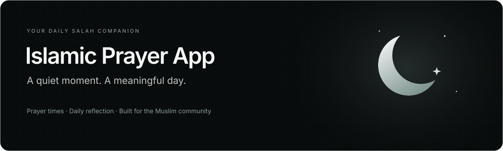

<div align="center">



<br />
<br />

**Stay connected to your prayers, wherever the day takes you.**

Live prayer times, a next-prayer countdown, and a Quran reflection.<br />
A responsive, open-source companion for the Muslim community.

<br />

[**Open live demo ↗**](https://islamic-prayer.pages.dev/) &nbsp; · &nbsp; [Report a bug](https://github.com/zayeefzahid/islamic-prayer-app/issues) &nbsp; · &nbsp; [Request a feature](https://github.com/zayeefzahid/islamic-prayer-app/issues)

<br />

[](https://github.com/zayeefzahid/islamic-prayer-app/actions/workflows/ci.yml)
[](https://react.dev/)
[](https://vite.dev/)
[](https://tailwindcss.com/)
[](LICENSE)

<br />

[Features](#features) · [Quick start](#quick-start) · [Configuration](#configuration) · [Deployment](#deployment) · [Contributing](#contributing)

</div>

<br />

## Overview

Islamic Prayer App brings the next prayer into focus with a live countdown, a daily schedule, and a verse to reflect on. Adjust your calculation convention, Asr school, clock format, and theme from one place; your preferences are saved for the next visit.

The interface pairs monochrome typography with particle-wave artwork and glass-style panels, adapting from desktop to mobile.

## Features

| Your day, at a glance | Preferences that stay with you |
| :--- | :--- |
| **Live countdown** — see the next prayer and time remaining. | **Calculation conventions** — choose from five regional methods. |
| **Daily schedule** — Fajr, Sunrise, Dhuhr, Asr, Maghrib, and Isha. | **Asr school** — Standard or Hanafi calculation. |
| **Local prayer times** — use your device location, with a permission prompt and retry action. | **Clock format** — switch between 12-hour and 24-hour time. |
| **Prayer status** — identify completed, current, next, and upcoming times. | **Appearance** — system, light, and dark theme preferences. |
| **Quran reflection** — Quran 2:45, Arabic text, translation, and optional recitation. | **Saved settings** — preferences persist in browser local storage. |

Keyboard focus indicators, loading states, fallback notices, and reduced-motion support are included.

## Quick start

**Prerequisites:** Node.js 22 and pnpm 10.4.1. The commands below run the repository's specified pnpm version through `npx`.

```bash
# Clone the repository
git clone https://github.com/zayeefzahid/islamic-prayer-app.git
cd islamic-prayer-app

# Install dependencies and start development
npx pnpm@10.4.1 install
npx pnpm@10.4.1 dev
```

Open the URL printed in your terminal, usually **http://localhost:5173**. No API key is required.

### Available commands

| Command | Description |
| :--- | :--- |
| `npx pnpm@10.4.1 dev` | Start the development server |
| `npx pnpm@10.4.1 build` | Generate the production build in `dist/` |
| `npx pnpm@10.4.1 preview` | Serve the production build locally |
| `npx pnpm@10.4.1 lint` | Run ESLint |
| `npx pnpm@10.4.1 test` | Run the Node.js test suite |

## Configuration

The default setup works without an environment file. To use a different prayer API endpoint, add a `.env.local` file at the project root:

```env
VITE_PRAYER_API_URL=https://api.aladhan.com/v1
```

Restart the development server after changing this value. Production changes require a new build.

<details>
<summary><strong>Location, calculation methods, and fallback behavior</strong></summary>

<br />

- **Location access:** the app requests browser geolocation on startup. The **Allow location** button lets you retry, and **Settings → Use current** refreshes your location.
- **Permission denied:** the app uses **New York, United States**, with a visible notice. If permission is blocked, enable it in your browser's site settings before retrying.
- **Calculation methods:** North America, Muslim World League, Karachi, Umm al-Qura, Makkah, and Egyptian Authority.
- **Asr calculation:** Standard (Shafi, Maliki, and Hanbali) or Hanafi.
- **Connection failure:** if the prayer API cannot be reached, the app displays clearly labeled **sample times**. These are demonstration data, not verified local prayer times.
- **Clock and timezone:** date handling and countdown calculations currently use the browser's local clock and timezone.
- **Secure context:** geolocation requires HTTPS in production; localhost works during development.

</details>

## Deployment

The app is hosted at **[islamic-prayer.pages.dev](https://islamic-prayer.pages.dev/)**.

To deploy your own copy with Cloudflare Pages, connect your fork and configure:

| Setting | Value |
| :--- | :--- |
| Production branch | `main` |
| Framework preset | React (Vite) |
| Build command | `npm run build` |
| Build output directory | `dist` |
| Root directory | Leave blank |

Environment variables are optional with the default API endpoint. Commit and push your changes before triggering a deployment.

The `dist/` directory can also be served by a static hosting provider with HTTPS.

## Built with

**React 19** · **Vite 6** · **Tailwind CSS 4** · **Lucide React**

Prayer times come from **Aladhan**, readable location names from **BigDataCloud**, and recitation audio from **Islamic Network**. Fonts are loaded through **Google Fonts**.

<details>
<summary><strong>Explore the project structure</strong></summary>

```text
islamic-prayer-app/
├── public/                   # Static assets and wave artwork
├── docs/                     # Repository artwork
├── src/
│   ├── components/           # Prayer UI, settings, reflection, and states
│   ├── hooks/                # Location, settings, and shared React hooks
│   ├── lib/
│   │   └── prayer-times.js   # Timeline, defaults, and time formatting
│   ├── services/
│   │   └── prayer-api.js     # API requests, geolocation, and fallbacks
│   ├── App.jsx               # App state and feature orchestration
│   ├── App.css               # Application styling
│   ├── index.css             # Global styles and theme tokens
│   └── main.jsx              # React entry point
├── tests/                    # Timeline, settings, and API regression tests
├── index.html
├── package.json
├── pnpm-lock.yaml
└── vite.config.js
```

</details>

## Automated checks

GitHub Actions runs tests, lint, and a production build on pull requests and pushes to `main`. You can also run **CI** manually from the repository's Actions tab. The workflow uses Node.js 22 and the pnpm version pinned in `package.json`.

Dependency installation uses the lockfile, and newer commits cancel older runs on the same branch or pull request. View results in the [Actions tab](https://github.com/zayeefzahid/islamic-prayer-app/actions/workflows/ci.yml).

## Contributing

Bug reports, accessibility improvements, and focused pull requests are welcome.

1. Open an [issue](https://github.com/zayeefzahid/islamic-prayer-app/issues) to discuss a substantial change.
2. Fork the repository and create a branch for your work.
3. Run `npx pnpm@10.4.1 test`, `npx pnpm@10.4.1 lint`, and `npx pnpm@10.4.1 build`.
4. Open a pull request describing the change and how you checked it.

## License

Distributed under the [MIT License](LICENSE).

---

<div align="center">

**Made for the Muslim community.**

Created by [Zayeef](https://zayeef.com) · [Try the app](https://islamic-prayer.pages.dev/)

</div>
